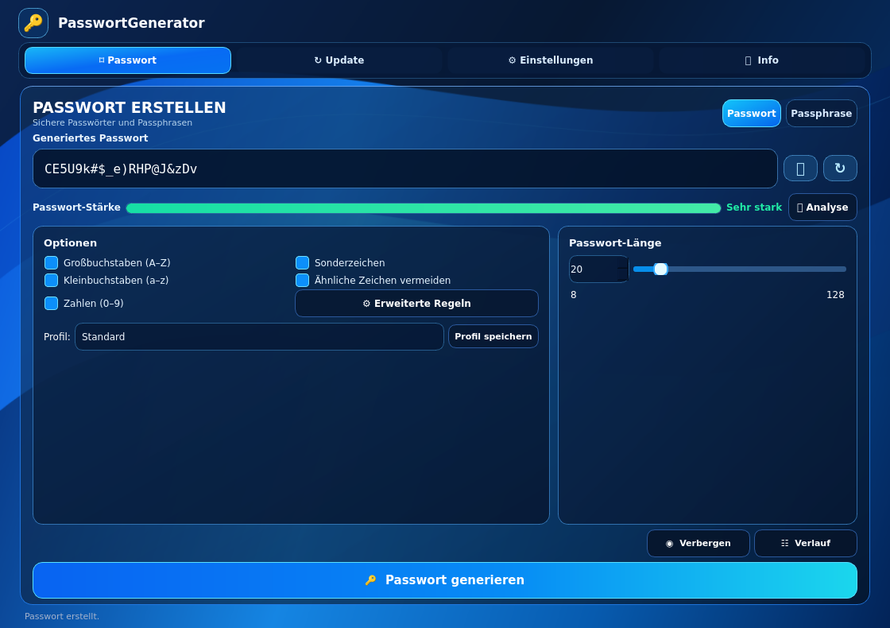

# PasswortGenerator

**Secure passwords and passphrases for Windows and Linux, with one consistent Ocean Glass interface.**

**Language / Sprache:** [Deutsch](README.md) | **English**

[](https://github.com/TimBooH/Passwort-Generator/releases/latest)
[](https://github.com/TimBooH/Passwort-Generator/actions/workflows/build-and-release.yml)
[](https://github.com/TimBooH/Passwort-Generator/actions/workflows/build-windows.yml)

## Download

| Windows 10/11 (64-bit) | Linux (x86_64, e.g. CachyOS) |
| --- | --- |
| [**Windows installer (.exe)**](https://github.com/TimBooH/Passwort-Generator/releases/download/v0.22.0/PasswortGenerator-Setup-x64.exe) | [**Linux AppImage**](https://github.com/TimBooH/Passwort-Generator/releases/download/v0.22.0/PasswortGenerator-x86_64.AppImage) |

[All releases and installation scripts](https://github.com/TimBooH/Passwort-Generator/releases/latest)

## Preview



*Real screenshot of the running Linux Qt/PySide6 application in the new Ocean Glass default theme. The displayed password was generated exclusively for this preview.*

## Features

- **Passwords:** 8–128 characters, profiles and advanced minimum digit/symbol and excluded-character rules.
- **Passphrases:** 4–10 words using independent German or English offline word lists, separators and optional two-digit number.
- **Ocean Glass default theme:** Bright blue/cyan navigation, separate **Options** and **Password length** glass panels, visible checkbox ticks and a full-width Generate button. The appearance is fixed: there is no theme picker or custom wallpaper setting.
- **Language:** Its own **Language** glass card directly below **Appearance** in Settings; German/English still applies throughout the app and is saved.
- **Updates:** Choose **Stable** or **Unstable** in-app. Test builds auto-update without downloading ZIP archives, installing separately from Stable; downloads are SHA-256 verified. Changelog and rollback remain available.
- **Security:** entropy-based strength explanation, privacy mode on focus loss and optional clipboard clearing after 30, 60 or 120 seconds.
- **Usability:** keyboard shortcuts (Ctrl+G, Ctrl+Shift+C, Ctrl+H, Ctrl+1–4), session history, guided tour and saved window geometry. Navigation: Password → Update → Settings → Info.

Passwords are generated locally using Python `secrets`. They are not sent to a server or saved permanently.

## Installation

**Windows:** Download and run the installer. Administrator approval is required; the app is installed to `C:\Program Files\PasswortGenerator`. The installer is not digitally signed, so Windows SmartScreen may show a warning.

**Linux with application-menu entry:** Download `install.sh` from the [latest release](https://github.com/TimBooH/Passwort-Generator/releases/latest) and run it in your downloads folder:

```bash
bash install.sh
```

**Linux without installation:** Run the downloaded AppImage directly:

```bash
chmod +x PasswortGenerator-x86_64.AppImage
./PasswortGenerator-x86_64.AppImage
```

Updates are installed **only after confirmation**. A regular Linux menu installation keeps the previous AppImage as a backup. An internet connection is required for update checks, but not for password generation.

## Development

Built with **Python and PySide6 (Qt 6)**. Run and test locally:

```bash
python -m pip install -r requirements.txt
python main.py
python -m unittest discover -s tests -v
```

Windows installers and Linux AppImages are built using [GitHub Actions](https://github.com/TimBooH/Passwort-Generator/actions).

**Version 0.22.0 · Step 22 of 100 toward the 1.0.0 release.**
[Release notes](RELEASE_NOTES.md) · [Releases](https://github.com/TimBooH/Passwort-Generator/releases)

*Made by Jon Bovi*
