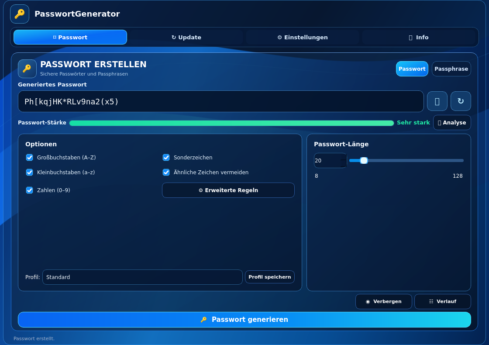

# PasswortGenerator

**Ein moderner Passwortgenerator für Linux und Windows mit anpassbarer Glasoberfläche, lokalen Hintergrundbildern und integrierter Updatefunktion.**

[](https://github.com/TimBooH/Passwort-Generator/releases/latest)
[](https://github.com/TimBooH/Passwort-Generator/releases/latest)
[](https://github.com/TimBooH/Passwort-Generator/releases/latest)
[](https://github.com/TimBooH/Passwort-Generator/actions/workflows/build-windows.yml)
[](https://github.com/TimBooH/Passwort-Generator/actions/workflows/build-and-release.yml)

PasswortGenerator ist eine Desktop-Anwendung für Linux und Windows, entwickelt mit **Python und Qt 6 (PySide6)**. Die Passworterzeugung erfolgt lokal mit dem kryptografisch sicheren Python-Modul `secrets`. Eine Internetverbindung ist dafür nicht erforderlich; sie wird lediglich für die optionale Updateprüfung und den Download neuer Versionen benötigt.

### Für Windows und Linux verfügbar

|  |  |
| :--- | :--- |
| **Windows 10 / 11** | **Linux (z. B. CachyOS / KDE)** |
| [**Windows-Installer herunterladen (.exe)**](https://github.com/TimBooH/Passwort-Generator/releases/download/v0.12.0/PasswortGenerator-Setup-x64.exe) | [**Linux-AppImage herunterladen**](https://github.com/TimBooH/Passwort-Generator/releases/download/v0.12.0/PasswortGenerator-x86_64.AppImage) |
| Installationsassistent, Startmenü-Eintrag und Deinstallation | Direkt ausführbar oder mit `install.sh` integrierbar |

**Aktuelle Version: v0.12.0** · [Alle Downloads](https://github.com/TimBooH/Passwort-Generator/releases/latest) · [Installationsanleitung](#installation) · [Updates](#updates)

## Vorschau



*Screenshot der echten PySide6-Anwendung, automatisch im Linux-Release-Build erstellt.*

---

## Funktionen

| Bereich | Möglichkeiten |
| --- | --- |
| **Passwörter** | 8–128 Zeichen; Klein- und Großbuchstaben, Zahlen und Sonderzeichen |
| **Passphrasen** | 4–10 zufällige zusammengesetzte Wörter; optional zweistellige Zufallszahl (10–99), Trennzeichen per Dropdown (-, Leerzeichen, _, .) |
| **Zeichenauswahl** | Ähnliche Zeichen optional ausschließen; jede aktivierte Zeichengruppe berücksichtigen |
| **Bedienung** | Alle vier Seiten ohne Scrollleisten; Fenstergröße und Fensterposition werden beim Schließen gespeichert und beim Start wiederhergestellt |
| **Verlauf** | Letzte 20 Ergebnisse nur während der Sitzung; kopieren oder löschen |
| **Stärke** | Geschätzte Entropie und visuelle Stärkeanzeige |
| **Design** | Neues Schema **Glass** mit stark durchsichtigen Glaskacheln, zusätzlich Glass Dark/Light und weitere Themes; Akzentfarbe folgt dem Hintergrund |
| **Hintergrundbilder** | Eigene PNG-, JPG-, WEBP- oder BMP-Dateien mit sechs Darstellungsmodi |
| **Updates** | Versionshistorie als Dropdown, Änderungen in eigener Glaskachel; kleiner Button „↻ Prüfen“ links, Startup-Popup und Zwei-Stunden-Prüfung |
| **Diagnose** | Lokales Crash-Protokoll mit Zeitstempel, Versionsnummer und verfügbaren Fehlerdetails |
| **Info** | Zwei eigene Glaskacheln für „Made by Jon Bovi“ und „Anleitung & Hilfe“, mit eingebetteten Bildern und Pfeil-Tour |

Die Oberfläche hat eine futuristische Glasoptik mit Schloss-Symbol, Akzentrahmen, Passwort/Passphrase-Umschalter, Stärkeanzeige und großem Generieren-Button. **Passwort, Einstellungen, Updates und Info** befinden sich als vier Bereiche gemeinsam **oben rechts**. **Info öffnet kein separates Fenster mehr.** Es gibt keine linke Seitenleiste und keinen zusätzlichen Info-Button am unteren Fensterrand.

## Versionsplan: 100 Schritte bis Version 1.0

Das Projekt verwendet ab sofort ein Entwicklungsschema mit **100 Meilensteinen bis zur ersten Vollversion**:

| Meilenstein | Version | Status |
| --- | --- | --- |
| **1 von 100** | `0.01.0` | Beginn der neuen Entwicklungsreihe |
| **2 von 100** | `0.02.0` | Glas-Deckkraft-Regler entfernt |
| **3 von 100** | `0.03.0` | Drei Reiter |
| **4 von 100** | `0.04.0` | Neon-Design und Passwort/Passphrase |
| **5 von 100** | `0.05.0` | Farbschemas, Changelog und Anleitung |
| **6 von 100** | `0.06.0` | Linke Navigation und kompakte Versionshistorie |
| **7 von 100** | `0.07.0` | Navigation oben rechts, transparenteres Glas und adaptive Farben |
| **8 von 100** | `0.08.1` | Update-Hinweis, 2-Stunden-Prüfung und Info vereinfacht |
| **9 von 100** | `0.09.0` | Grafische Erklärung, Passphrase-Optionen und Windows-Installation in Programme |
| **10 von 100** | `0.10.0` | Start-Update-Popup, Glass-Durchsicht, erste Tour mit Pfeilen |
| **11 von 100** | `0.11.0` | Richtig platzierte Pfeile, Info im Hauptfenster, kein Scrollen |
| **12 von 100** | **`0.12.0`** | **Aktueller Stand: Versions-Dropdown, getrennte Kacheln, kompakter Update-Button, gespeicherte Fensterposition/-größe** |
| **50 von 100** | `0.50.0` | Halbzeit |
| **99 von 100** | `0.99.0` | Letzter Entwicklungsschritt |
| **100 von 100** | **`1.0.0`** | **Erste Vollversion** |

Die dritte Stelle ist für kleine Korrekturen innerhalb eines Schritts reserviert (z. B. `0.07.1`). Ein Meilenstein wird nur erhöht, wenn bewusst der nächste Entwicklungsschritt veröffentlicht wird.

**Hinweis für bisherige Linux-Installationen:** Die bisherigen Versionen `1.2.0` bis `1.5.1` stammen aus dem alten Nummerierungssystem und bleiben als historische Releases erhalten. Weil die neue Reihe wieder bei `0.01.0` beginnt, können die alten Apps diese Version beim automatischen Update als niedriger einstufen. **Bitte `0.01.0` einmal über den aktuellen Installer von GitHub installieren.** Anschließend funktionieren die Updates innerhalb der neuen Versionsreihe wieder regulär. Die Installer-Sicherung der vorherigen AppImage-Version bleibt erhalten.

## Download

Aktuelle Installationsdateien für **Linux x86_64 und Windows x64** findest du unter **[GitHub Releases](https://github.com/TimBooH/Passwort-Generator/releases/latest)**.

| Datei | Zweck |
| --- | --- |
| `PasswortGenerator-x86_64.AppImage` | Portable Linux-Anwendung |
| `PasswortGenerator-Setup-x64.exe` | Windows-Installer mit Startmenü-Verknüpfung und Deinstallation |
| `SHA256SUMS-windows.txt` | Prüfsumme des Windows-Installers |
| `install.sh` | Benutzerinstallation mit Anwendungsmenü-Eintrag |
| `uninstall.sh` | Entfernt die installierte Anwendung und den Menüeintrag |
| `SHA256SUMS` | SHA-256-Prüfsumme des AppImages |

**Systemanforderungen:** Linux x86_64 (z. B. CachyOS/KDE) oder Windows 10/11 x64. Für AppImages kann eine kompatible FUSE-Laufzeit erforderlich sein. Der Windows-Installer ist noch nicht digital signiert; Microsoft SmartScreen kann deshalb eine Warnung anzeigen.

## Installation

### Windows 10/11 (64 Bit)

1. Lade **[PasswortGenerator-Setup-x64.exe](https://github.com/TimBooH/Passwort-Generator/releases/latest)** aus dem aktuellen GitHub-Release herunter.
2. Öffne die EXE-Datei und bestätige die **Windows-Administratorabfrage**; folge dem deutschsprachigen Installationsassistenten.
3. Der Installer installiert unter **`C:\Program Files\PasswortGenerator`** und legt einen **Startmenü-Eintrag** an. Eine Desktop-Verknüpfung kannst du optional aktivieren.
4. Unter **Windows-Einstellungen → Apps → Installierte Apps** kannst du PasswortGenerator später deinstallieren.

**Neuer Installationsort ab v0.09.0:** Der Windows-Installer installiert für alle Benutzer standardmäßig unter **`C:\Program Files\PasswortGenerator`** (im Explorer: `C:\Programme`). Der Installer benötigt deshalb eine **Administratorbestätigung (Windows-UAC)**, auch beim Update innerhalb der App. Bei der 64-Bit-Version wird der normale Ordner **„Programme“**, nicht „Programme (x86)“, verwendet. Die Benutzereinstellungen bleiben erhalten.

**Wichtiger einmaliger Umstieg von v0.08.1 oder älter:** Starte den neuen Windows-Installer **manuell über die Release-Seite**. Der Update-Button älterer Versionen kann noch keine Administratorrechte anfordern und wird diesen Installationswechsel deshalb nicht zuverlässig durchführen. Diese Versionen wurden unter `%LOCALAPPDATA%\Programs\PasswortGenerator` installiert. Da eine bestehende Benutzerinstallation nicht automatisch in eine systemweite Installation umgewandelt werden kann, **kann sie nach dem neuen Setup zusätzlich bestehen bleiben**. Entferne den alten Eintrag anschließend über **Windows-Einstellungen → Installierte Apps**, damit keine zwei Installationen/Startmenü-Verknüpfungen vorhanden sind. Die neue Version startet über den neuen Startmenü-Eintrag. Alternativ kannst du die alte Installation vor dem ersten neuen Setup manuell deinstallieren. Unter Linux ändert sich kein Installationspfad.

Der Update-Reiter lädt auf Windows ausschließlich den Windows-Installer und auf Linux das AppImage. Bei Windows-Updates fragt die App vor dem Start des neuen Installers nach Administratorrechten, sofern erforderlich.

**Hinweis:** Die EXE ist nicht mit einem kostenpflichtigen Code-Signing-Zertifikat signiert. Windows SmartScreen kann beim ersten Start eine Warnung zeigen. Lade sie ausschließlich aus dem offiziellen GitHub-Release herunter und prüfe bei Bedarf `SHA256SUMS-windows.txt`.

### Linux: Installation mit Menüeintrag

1. Lade `install.sh` von der [Release-Seite](https://github.com/TimBooH/Passwort-Generator/releases/latest) herunter.
2. Öffne ein Terminal im Downloadordner.
3. Führe den Installer aus:

   ```bash
   bash install.sh
   ```

Das Skript lädt das aktuelle AppImage herunter, prüft die veröffentlichte SHA-256-Prüfsumme und erstellt einen Eintrag im Linux-Anwendungsmenü. **Für die Benutzerinstallation ist kein `sudo` nötig.** Danach kannst du PasswortGenerator über das KDE-Menü öffnen und an die Taskleiste anheften.

**Bereits heruntergeladenes AppImage installieren:**

```bash
bash install.sh --file ./PasswortGenerator-x86_64.AppImage
```

Bei `--file` wird die angegebene lokale Datei verwendet. Lade sie nur aus einer vertrauenswürdigen Quelle herunter; die Online-Prüfsummenprüfung des Installers findet bei diesem Aufruf nicht statt.

### Portable Nutzung ohne Installation

Lade das AppImage herunter und starte es im entsprechenden Verzeichnis:

```bash
chmod +x PasswortGenerator-x86_64.AppImage
./PasswortGenerator-x86_64.AppImage
```

Hierbei wird kein Anwendungsmenü-Eintrag erstellt.

### Installationspfade

| Komponente | Pfad |
| --- | --- |
| Aktuelle Version | `~/.local/opt/passwort-generator/PasswortGenerator.AppImage` |
| Vorherige Version | `~/.local/opt/passwort-generator/PasswortGenerator-previous.AppImage` |
| Menüeintrag | `~/.local/share/applications/de.timbooh.passwortgenerator.desktop` |
| Programmsymbol | `~/.local/share/icons/hicolor/scalable/apps/de.timbooh.passwortgenerator.svg` |

Die Datei für die vorherige Version wird erst angelegt, wenn eine vorhandene Installation aktualisiert wird.

## Updates

PasswortGenerator prüft **beim Start und danach alle 2 Stunden, solange die App geöffnet ist**, ob eine neue Veröffentlichung im Repository [TimBooH/Passwort-Generator](https://github.com/TimBooH/Passwort-Generator) bereitsteht. **Wenn beim Start eine passende neue Windows- oder Linux-Version erkannt wird, öffnet sich ein Popup mit „Updates öffnen“ und „Später“.** Es führt nur zum Update-Bereich, ohne etwas automatisch zu installieren. Der Button **„↻ Updates • NEU“ oben rechts** zeigt die Aktualisierung zusätzlich an. Prüfungen nach dem Start aktualisieren den Hinweis, ohne wiederholt Popups zu zeigen. Ohne Internet bleibt die Passworterstellung nutzbar. **Updates werden nie ohne deine Bestätigung installiert.**

**Beim ersten Start:** Eine Einführung legt eine halbtransparente Ebene über die laufende App und zeigt mit **präzise auf die echten Bedienelemente ausgerichteten Pfeilen**, wie du Passwortlänge, Passphrase-Zufallszahl, Trennzeichen, Generieren, Designs und Updates verwendest. Du kannst mit „Weiter“, „Zurück“ und „Überspringen“ navigieren. Nach Abschluss oder Überspringen erscheint sie bei weiteren Starts nicht erneut. Unter **Info → Tour mit Pfeilen** kann sie jederzeit wiederholt werden, ohne ein zusätzliches Fenster zu öffnen. Wird während der Tour ein Update gefunden, erscheint das Update-Popup erst danach.

### Changelog und frühere Versionen

Der Update-Bereich enthält **drei getrennte Glaskacheln**: **„Update & Version“** mit einem kleinen linksbündigen Button **„↻ Prüfen“**, darunter **„Bisherige Versionen“** mit einem **Dropdown** und direkt darunter die Kachel **„Änderungen & Versionen“**. Beim ersten Öffnen lädt das Dropdown bis zu **100 veröffentlichte Releases** von GitHub. **Die neueste Veröffentlichung steht oben, die älteste unten**, einschließlich historischer 1.x-Versionen; maßgeblich ist das Veröffentlichungsdatum. Die Auswahl im Dropdown zeigt sofort **maximal fünf kurze Änderungspunkte** in der darunterliegenden Kachel. Das Auswählen installiert keine ältere Version. Die früheren „Neuer/Älter“-Buttons entfallen.

**Wichtig:** Die Liste dient der Information; ein Anklicken installiert **keine** ältere Version. Ohne Internetverbindung bleibt die Passworterzeugung nutzbar, die Online-Versionshistorie ist dann nicht abrufbar.

1. Wenn eine neue Version verfügbar ist, wähle **„Update installieren & neu starten“**.
2. Das AppImage wird heruntergeladen und anhand der veröffentlichten **Dateigröße und SHA-256-Prüfsumme** überprüft.
3. Bei einer Menü-Installation wird die bisherige Version als `PasswortGenerator-previous.AppImage` gesichert und das aktuelle AppImage ersetzt.
4. Nach erfolgreichem Download und Austausch startet die neue Version automatisch.

**Versionsverwaltung:** Im Installationsordner werden die aktuelle und die unmittelbar vorherige AppImage-Version aufbewahrt. Ältere, zur Anwendung gehörende Versionen werden dort entfernt.

**Portable AppImages:** Wird das Programm ohne Installation gestartet, landet die heruntergeladene Version im Downloadordner und wird von dort neu gestartet. Die `previous`-Sicherung gilt für die reguläre Menü-Installation.

Die App prüft optional auf Updates, **installiert sie aber nur nach deinem Klick**.

### Fenstergröße und Position

Die App speichert beim normalen Schließen **Fenstergröße und Position** in den lokalen Programmeinstellungen (QSettings). Beim nächsten Start wird beides wiederhergestellt, sofern die Fensterposition auf den verfügbaren Bildschirmen noch nutzbar ist. Auch ein maximiertes Fenster wird berücksichtigt. **Passwörter und die temporäre Passworthistorie werden nicht gespeichert.** Windows und Linux verwenden dieselbe Funktion.

## Oberfläche und Hintergrundbilder

Die **kleineren, platzsparenden Buttons** befinden sich **oben rechts**. Drei wechseln den Bereich, der vierte öffnet **Info**. Bei einem neuen Update wird „NEU“ angezeigt:

| Reiter | Inhalt |
| --- | --- |
| **Passwort** | Passwort/Passphrase, Stärkebalken, Längenregler, Zeichengruppen, Anzeigen und Verlauf |
| **Einstellungen** | Zwei Kacheln: Design & Farben sowie Hintergrundbild und Bilddarstellung |
| **Updates** | Drei Kacheln: kompakte Updateprüfung links, bisherige Versionen als Dropdown, Änderungen darunter |
| **Info** | Zwei eigene Glaskacheln für „Made by Jon Bovi“ und „Anleitung & Hilfe“, mit eingebetteten Bildern und Pfeil-Tour |

Wechsle über die **kleinen Schaltflächen oben rechts** zwischen den Bereichen. **Alle vier Seiten kommen ohne Seiten-Scrollleisten aus.** Die Versionshistorie ist jetzt ein **Dropdown**: Wähle eine Version aus, um ihre kurzen Änderungen in der Kachel darunter anzuzeigen. Bei **Passphrase** kannst du mit einem Kontrollkästchen eine **zufällige zweistellige Zahl (10–99) anhängen**. Das **Trennzeichen** wählst du im Dropdown (Bindestrich, Leerzeichen, Unterstrich oder Punkt); es trennt sowohl die Wörter als auch die angehängte Zahl. Die Zufallszahl wird mit `secrets` kryptografisch sicher erzeugt.

Unter **Info** gibt es nun **zwei eigenständige Glaskacheln**: **„Made by Jon Bovi“** mit Versionsnummer und kurzer Programmbeschreibung sowie **„Anleitung & Hilfe“**. In der Hilfe-Kachel zeigt **„Grafische Erklärung“** drei bebilderte Ansichten direkt im Reiter (ohne Popup), und **„Tour mit Pfeilen“** startet die Einführung erneut. Die lange Textanleitung bleibt entfernt. Die Bilder werden nur im Arbeitsspeicher erzeugt. Das funktioniert unter **Windows und Linux**.

Im Reiter **„Einstellungen“** unter **„Design & Farben“** wählst du ein **Farbschema**: **Glass (durchsichtig)**, **Neon Blue**, **Glass Dark**, **Glass Light**, **Violet Glass** oder **Forest Glass**. Das neue pure **Glass** reduziert die Deckkraft der Glaskacheln deutlich, damit das Bild und die Dekoration **im Hintergrund der App** sichtbar sind (kein systemweiter Desktop-Unschärfeeffekt). Die App wählt eine **automatisch gut lesbare Textfarbe**, die nicht mehr manuell eingestellt werden muss. Die **Akzentfarbe übernimmt den Farbton des gewählten Hintergrunds** und wird auf einen gut sichtbaren Kontrast abgestimmt. Bei eigenen Hintergrundbildern fließt ein repräsentativer Bildfarbton in die Akzentwahl ein. Das aktualisiert Rahmen, Buttons und Regler; das dekorative Schaltkreismuster bleibt aus Stabilitätsgründen unverändert. Bei manueller Hintergrundfarbwahl schaltet die App auf **„Eigene Farben“**. Die transparenten Glas-Kacheln haben eine feste, reduzierte Deckkraft ohne zusätzlichen Regler. Die Glasoptik wird innerhalb des Programmfensters dargestellt; eine tatsächliche Unschärfe des Desktops hinter dem Fenster ist nicht erforderlich.

Mit **„Bild auswählen …“** kannst du ein eigenes Hintergrundbild laden und dessen Darstellung festlegen:

| Modus | Darstellung |
| --- | --- |
| **Ausfüllen** | Füllt den verfügbaren Bereich proportional; Bildränder können abgeschnitten werden |
| **Einpassen** | Zeigt das gesamte Bild proportional mit möglichen freien Rändern |
| **Gestreckt** | Passt Breite und Höhe unabhängig an; das Bild kann verzerrt werden |
| **Zentriert (100 %)** | Platziert das Bild ohne weitere Skalierung mittig |
| **Original (links oben)** | Platziert das Bild ohne weitere Skalierung oben links |
| **Gekachelt** | Wiederholt das Bild als Muster |

Mit **„Bild entfernen“** wechselst du zum farbigen Hintergrund zurück. Das Originalbild bleibt an seinem Speicherort; gespeichert wird sein Dateipfad.

**Hinweis zur Bildgröße:** Bilder über 30 MB oder mit extrem großen Abmessungen werden abgelehnt. Große unterstützte Bilder können beim Laden auf maximal 4096 Pixel Kantenlänge reduziert werden. Die Modi „Zentriert“ und „Original“ beziehen sich dann auf diese geladene Auflösung.

## Fehlerdiagnose

Der Crash-Log-Button ist auf Wunsch aus der Oberfläche entfernt. Die Fehlerdiagnose läuft weiterhin automatisch; das lokale Protokoll findest du unter:

```text
~/.local/state/passwort-generator/crash.log
```

Wenn `XDG_STATE_HOME` gesetzt ist, wird dessen Verzeichnis verwendet. Das Protokoll kann Zeitstempel, App-Version, Prozess-ID, letzte Bedienaktionen, Python-Exceptions, Stacktraces und verfügbare Qt-/Systemmeldungen enthalten.

**Wichtig:** Die zuletzt protokollierte Aktion muss nicht die Ursache des Absturzes sein. Insbesondere bei nativen Qt-, Grafiktreiber- oder Speicherfehlern ist eine eindeutige Diagnose nicht immer möglich.

Bei Problemen unter KDE/Wayland kann testweise ein Start über XWayland helfen, sofern XWayland installiert ist:

```bash
QT_QPA_PLATFORM=xcb ~/.local/opt/passwort-generator/PasswortGenerator.AppImage
```

Falls die Anwendung erneut abstürzt, füge bei einer Fehlermeldung möglichst den relevanten Logabschnitt und die Schritte zur Reproduktion hinzu.

## Deinstallation

Lade `uninstall.sh` aus den [Release-Assets](https://github.com/TimBooH/Passwort-Generator/releases/latest) herunter und starte:

```bash
bash uninstall.sh
```

Der Installer-Eintrag sowie die aktuelle und die vorherige AppImage-Datei werden entfernt. Gespeicherte Benutzereinstellungen bleiben bestehen.

## Entwicklung

### Lokal aus dem Quellcode starten

Benötigt werden **Python 3.11 oder neuer**, ein Linux-Desktop mit Qt-Unterstützung und die von Qt benötigten Systembibliotheken.

```bash
git clone https://github.com/TimBooH/Passwort-Generator.git
cd Passwort-Generator

python -m venv .venv
source .venv/bin/activate
python -m pip install -r requirements.txt
python main.py
```

### Tests

```bash
python -m unittest discover -s tests -v
```

Für zusätzliche GUI- und Update-Integrationstests in einer Umgebung mit Qt:

```bash
QT_QPA_PLATFORM=offscreen PYTHONPATH=. python tests/smoke_glossy_ui.py
QT_QPA_PLATFORM=offscreen PYTHONPATH=. python tests/smoke_update_gui.py
```

### Build und Release

Das Repository verwendet zwei GitHub-Workflows: **[Linux AppImage](https://github.com/TimBooH/Passwort-Generator/actions/workflows/build-and-release.yml)** und **[Windows Installer](https://github.com/TimBooH/Passwort-Generator/actions/workflows/build-windows.yml)**. Windows wird auf einem echten Windows-Runner mit PyInstaller und Inno Setup kompiliert. Beide Installationsdateien gehören zum selben Versions-Release.

Ein automatischer Release-Lauf startet bei einer Änderung von `version.py` auf `main`. Änderungen am Workflow lösen ebenfalls einen Versionscheck aus; ein bereits existierendes Release wird übersprungen. Manuelle Ausführung ist über **Run workflow** möglich.

**Für ein neues Release:** Programmänderungen und Tests abschließen, `APP_VERSION` in `version.py` erhöhen, `RELEASE_NOTES.md` aktualisieren und alles gemeinsam committen. Nach bestandenen Tests werden das AppImage, Installationsskripte und `SHA256SUMS` veröffentlicht. Reine README-Änderungen lösen keinen Release-Build aus. Der Windows-Workflow wird bei einer neuen Versionsnummer oder nach einer Workflow-Änderung ausgeführt und überspringt bereits vorhandene Windows-Installer.


## Sicherheit und Datenschutz

- Passwörter werden **lokal generiert** und nicht an einen Server übertragen.
- Generierte Passwörter werden von der Anwendung nicht dauerhaft gespeichert.
- Für die Updateprüfung werden öffentliche Release-Metadaten von GitHub abgerufen.
- AppImage-Downloads werden vor der Installation anhand der GitHub-Prüfsumme geprüft.
- Crash-Logs bleiben lokal und werden nicht automatisch hochgeladen.
- **Zwischenablage:** Kopierte Passwörter können für andere Programme sichtbar sein, bis sie überschrieben oder aus der Zwischenablage entfernt werden.

---

**Projekt:** [TimBooH/Passwort-Generator](https://github.com/TimBooH/Passwort-Generator) · **[Releases](https://github.com/TimBooH/Passwort-Generator/releases)** · **[Build-Status](https://github.com/TimBooH/Passwort-Generator/actions/workflows/build-and-release.yml)**
